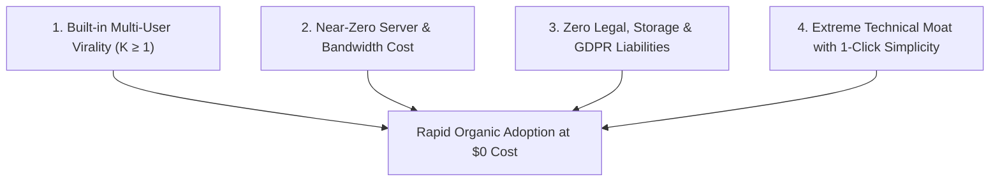
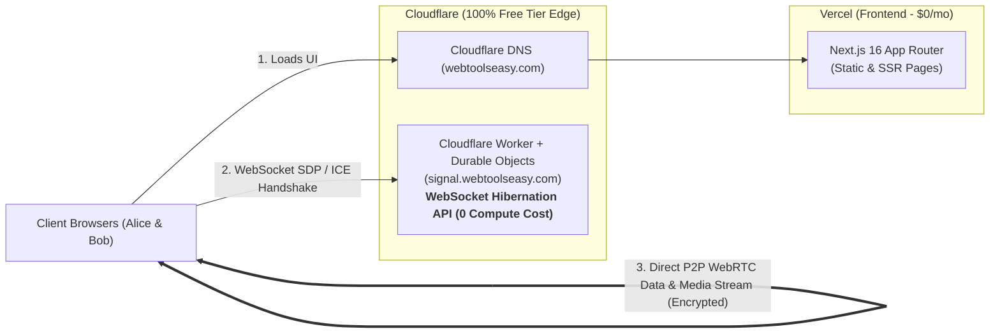
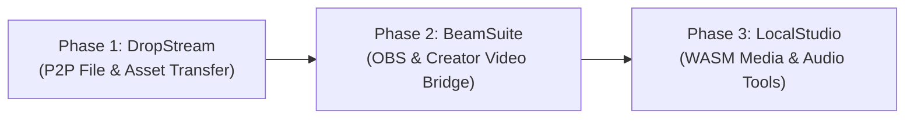

# Product Revamp Strategy & Market Research: WebToolsEasy

## 1. Executive Summary & Diagnostic

### 1.1 The Current State of WebToolsEasy
WebToolsEasy currently hosts 110+ browser-based utility tools covering JSON formatting, PDF operations, basic calculators, text manipulations, and SEO meta generators. Despite solid engineering (Next.js 16 App Router, TypeScript, Material UI/Tailwind), the platform has plateaued with minimal organic traction.

### 1.2 The Diagnostic: Why Commodity Web Tools Fail to Gain Traction Today
1. **The Google SEO Monopoly (Red Ocean)**:
   - Keywords like *"json formatter"*, *"image compressor"*, *"pdf merge"*, and *"loan calculator"* are completely dominated by legacy sites (*iLovePDF, SmallSEOTools, CloudConvert, TinyWow, Bankrate*) holding Domain Ratings (DR) of 75–90+ with 10–15 years of accumulated backlinks.
   - Low-authority domains cannot compete organically for head search terms without massive domain authority or backlink buying.
2. **AI & Native Workflow Cannibalization (2024–2026)**:
   - Millions of developers, students, and office workers now execute formatting, regex, SQL/CSV parsing, and password generation directly inside **ChatGPT, Claude, Cursor, GitHub Copilot, or OS launchers like Raycast/Alfred**.
   - The consumer habit of opening a browser tab for simple text manipulation is vanishing.
3. **Single-Player, Zero-Virality Architecture ($K = 0$)**:
   - A generic utility tool is single-player. A user pastes a JSON blob or converts a timestamp, copies the result, and closes the tab.
   - Zero word-of-mouth or network effects occur. Virality coefficient $K = 0$.

### 1.3 Strategic Decision: Preserve Legacy, Pivot the Core
- **Do not delete or break existing tools**: Keep the existing 110 tools under their current routes (or organize them into an archive `/utilities`) so existing indexed URLs and long-tail SEO pages are preserved.
- **Pivot the core brand and homepage**: Transition from a generic "commodity tool directory" into a **high-performance, privacy-first, zero-cloud suite powered by WebRTC, WebAssembly, WebCodecs, and WebGPU**.

---

## 2. The Modern Playbook: How High-Traction Web Tools Win Today

To achieve rapid, organic adoption with near-zero marketing spend, tools must satisfy four core pillars:

1. **Built-in Viral Loop ($K \ge 1$)**: When User A uses the tool, they *must* send a link to User B (recipient, guest, client, or audience). Every single session acquires another potential user for free.
2. **Near-Zero Server Cost ($0 – $5/mo)**: By using WebRTC (DataChannels / MediaStreams) and WebAssembly, 99.9% of bandwidth and compute is executed on client hardware. The server only handles lightweight JSON signaling and free STUN/ICE traversal.
3. **Zero Legal / Storage Liability**: Zero user files or video feeds are ever stored on a server. No disk storage costs, zero DMCA copyright takedown liabilities, zero GDPR data-at-rest exposure.
4. **High Technical Moat & 1-Click Simplicity**: Replaces multi-gigabyte desktop software (OBS plugins, WeTransfer Pro, desktop video converters, ngrok) with a frictionless 1-click browser experience.

---

## 3. Product Revamp Themes Evaluated

### Option 1: "BeamSuite" — P2P Real-Time Streaming & Creator Studio
- **The Problem**: Streamers, remote interviewers, podcasters, and educators need to bridge cameras, screens, and audio feeds across devices or into OBS Studio / vMix.
- **The Competition & Flaws**:
  - *StreamYard / Riverside*: Charge $20–$50/mo, impose recording limits, and add watermarks on free tiers.
  - *VDO.ninja (OBS.ninja)*: Extremely capable under the hood, but notoriously suffers from a dated, unintuitive 1990s UI with cryptic URL parameters (`&push=xxx&view=xxx`).
- **High-Value Tools**:
  1. *Phone-to-OBS Camera Beam*: Scan QR code on iPhone/Android; streams back camera (4K/1080p, torch, zoom, focus lock) directly to an OBS browser source with tally light.
  2. *Low-Latency Screen Beam with Remote Laser Pointer*: 60fps screen share with client/collaborator; recipient can point, draw, and annotate live without Zoom/Teams install.
  3. *Ephemeral Production Intercom*: Push-to-talk crew walkie-talkie and isolated guest audio tracks with instant local high-bitrate recording.

### Option 2: "DropStream" — Next-Gen Unlimited P2P File & Asset Transfer
- **The Problem**: Transferring large video files, RAW photos, 3D assets, and multi-gigabyte folders between colleagues or across one's own devices is slow, heavily paywalled, or throttled.
- **The Competition & Flaws**:
  - *WeTransfer*: Caps free transfers at 2GB, requires slow cloud uploads (uploading 20GB takes hours before download can start), and deletes files after 7 days.
  - *Snapdrop*: Acquired and overwhelmed with LimeWire ads, crypto banners, and degraded routing (1.24M monthly visits despite user frustration).
  - *PairDrop*: Popular open-source fork (11.6k GitHub stars), but primarily focused on local Wi-Fi pairing and lacks chunked resumption across internet rooms.
- **High-Value Tools**:
  1. *Unlimited P2P Folder & File Streamer*: Drag & drop 50GB+ folders; generates a 6-digit code or QR code; streams direct peer-to-peer using chunked WebRTC DataChannels and File System Access API. Zero cloud storage.
  2. *Cross-Device Universal Clipboard*: Instant pairing for auth tokens, passwords, 2FA keys, code snippets, and images with auto-burn on close.
  3. *Local LAN Radar*: Automatic discovery of devices on the same Wi-Fi subnet.
  4. *In-Browser WebTorrent Seeder*: Instant peer-to-peer distribution to multiple recipients without central server bandwidth.

### Option 3: "LocalStudio" — Zero-Upload Private Media & Audio Engineering
- **The Problem**: Fast video trimming, vocal removal, and audio transcription currently require either uploading gigabytes to cloud converters (which watermark or paywall) or installing multi-gigabyte desktop software.
- **The Competition & Flaws**:
  - Cloud tools (*Kapwing, 123apps, Clipchamp*) throttle speeds, force cloud uploads, and slap watermarks.
  - Desktop tools (*LosslessCut, Audacity, Premiere*) require native installation and manual updates.
- **High-Value Tools**:
  1. *Lossless Keyframe Video Cutter (WebCodecs + FFmpeg.wasm)*: Cuts MP4/MKV/MOV on keyframes in 0.1 seconds without re-encoding and with zero quality loss.
  2. *In-Browser AI Vocal & Stem Separator*: Runs quantized ONNX Demucs/MDX via WebGPU. Isolates vocals and instruments directly in browser RAM.
  3. *Private In-Browser Audio Transcriber*: Uses Transformers.js (Whisper) locally. Generates `.srt`, `.vtt`, and timestamped transcripts with 100% privacy.

### Option 4: "DevEdge" — High-Performance Zero-Cloud Developer Suite
- **Tools**: P2P WebRTC Localhost Tunnel (ngrok alternative with no account), In-Browser Parquet & Massive CSV SQL Profiler (DuckDB-WASM), Disposable Webhook Interceptor with cURL replay.

---

## 4. Multi-Option Coexistence under `webtoolseasy.com`

### 4.1 Can We Build Options 1, 2, and 3 Together?
**Yes.** All three options share the exact same technical DNA: client-side execution, zero server file storage, zero accounts, and extreme privacy.

### 4.2 Adverse Effects & Mitigation Strategy

| Adverse Effect | Risk | Mitigation Blueprint |
| :--- | :--- | :--- |
| **Brand Perception Mismatch** | `webtoolseasy` sounds like a low-effort 2012 utility directory; high-end creators or privacy-sensitive users might hesitate. | Use clean dedicated subpaths (e.g. `webtoolseasy.com/drop`, `webtoolseasy.com/beam`, `webtoolseasy.com/studio`) or subdomains (`drop.webtoolseasy.com`). The interface must look and feel like a modern, standalone product. |
| **"Swiss Army Knife" Confusion** | Trying to pitch 115 tools at once diffuses marketing impact on Hacker News / Reddit / ProductHunt. | Do **not** launch "WebToolsEasy". Launch each flagship tool independently: e.g., *"Show HN: DropStream – Instant 50GB P2P Folder Streaming in your browser"*. |
| **Topical SEO Dilution** | Google prefers narrow niche authority rather than a catch-all domain. | Create distinct topical hubs with specialized schema and deep educational guides tailored to each tool's search intent. |
| **Engineering Scope Creep** | Building 3 complex engines simultaneously risks developer burnout and delayed launches. | **Strict sequential execution**: Build and launch Phase 1 first, validate adoption, then build Phase 2. |
| **Bundle & WASM Asset Bloat** | Heavy WASM binaries (FFmpeg is ~25MB; ONNX models are 50–150MB) can ruin Core Web Vitals and page load speeds. | Use strict Next.js dynamic imports (`next/dynamic`), Web Workers, and lazy download triggers so code only loads when entering that specific tool. |

---

## 5. Deployment Architecture & Monthly Cost Breakdown

### 5.1 Component Breakdown
1. **Frontend App (`webtoolseasy.com`)**:
   - **Host**: Vercel (Hobby plan).
   - **Role**: Serves the Next.js 16 App Router, UI components, WebRTC client logic, and WASM loaders.
   - **Cost**: **$0.00 / month**.
2. **DNS, CDN & SSL**:
   - **Host**: Cloudflare (Free plan).
   - **Role**: Handles root domain and subdomains, SSL termination, caching, and WebSocket edge routing.
   - **Cost**: **$0.00 / month**.
3. **WebRTC Signaling Server (`signal.webtoolseasy.com`)**:
   - **Host**: Cloudflare Workers + Durable Objects (Free tier).
   - **Role**: Serverless WebSocket signaling using the WebSocket Hibernation API. Each room (e.g. `ABC123`) is a lightweight Durable Object. When peers are idle, the object hibernates at **0 GB-seconds compute cost**.
   - **Cost**: **$0.00 / month** (within Cloudflare's 100,000 free requests/day limit).
4. **STUN / TURN Relays**:
   - **STUN**: Public Google STUN servers (`stun:stun.l.google.com:19302`) for 85–90% direct P2P connections.
   - **TURN Fallback**: Cloudflare Calls or Metered.ca free tier (50GB free relay/mo) for symmetric NAT traversal.
   - **Cost**: **$0.00 / month**.

### 5.2 Total Monthly Operating Cost Summary

| Service | Provider | Current Tier | Incremental Cost |
| :--- | :--- | :--- | :--- |
| Frontend Web App | Vercel | Hobby Plan | **$0.00** |
| DNS, SSL & Edge Routing | Cloudflare | Free Plan | **$0.00** |
| WebSocket Signaling (Durable Objects) | Cloudflare | Free Plan (100k req/day) | **$0.00** |
| STUN & NAT Traversal | Google STUN / Cloudflare | Free | **$0.00** |
| Database (Optional Analytics) | Railway Postgres (`rare-dedication`) | Existing Hobby DB | **$0.00** |
| **Total Monthly Out-of-Pocket** | | | **$0.00 / month** |

---

## 6. Recommended Execution Order

### Phase 1: DropStream (P2P File & Folder Transfer)
- **Why First**:
  1. Establishes the foundational WebSocket signaling service and WebRTC DataChannel engine.
  2. Solves the Snapdrop/WeTransfer pain point immediately.
  3. Has the strongest inherent virality ($K \ge 1$): every transfer forces the sender to invite a recipient.
- **Key Milestones**:
  - Deploy lightweight WebSocket signaling service to Railway and point `signal.webtoolseasy.com` via Cloudflare.
  - Implement WebRTC DataChannel with chunked streaming and File System Access API.
  - Build clean, modern UI at `/drop` with 6-digit room code, QR pairing, and progress telemetry.

### Phase 2: BeamSuite (P2P Camera & OBS Video Bridge)
- **Why Second**:
  1. Reuses the exact same Railway signaling server and room management built in Phase 1.
  2. Switches from `RTCDataChannel` to `MediaStream` (video/audio).
  3. Introduces OBS Studio browser source compatibility, camera orientation switching, and remote screen sharing.

### Phase 3: LocalStudio (WASM & WebGPU Media Tools)
- **Why Third**:
  1. Completely client-side; requires zero server infrastructure.
  2. Adds massive utility and "wow" factor for content creators attracted during Phase 1 & 2.
  3. Implements Lossless Video Keyframe Cutter (WebCodecs) and in-browser AI vocal separation/transcription.
